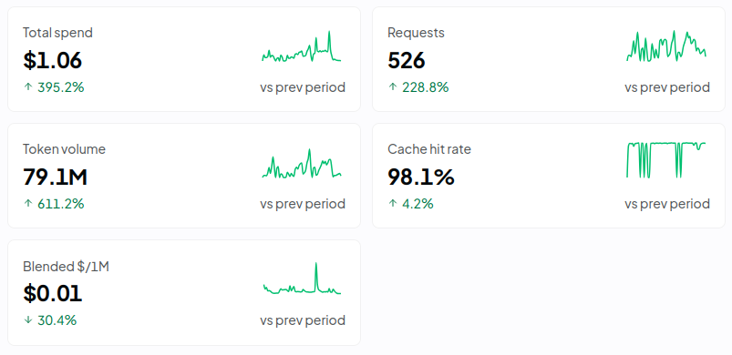

# Moncho

A terminal coding agent that runs itself: it reads, patches, searches and runs
commands, then shows you what it did. It runs in a container, keeps its own state out
of your repository, and talks to any OpenAI-compatible provider or to Ollama.

- **Tools with an intent.** Every call carries a short phrase saying why, shown next to
  the result and kept in the context.
- **A sandbox, not a shell.** `run_bash` accepts one allow-listed command and no shell
  metacharacters; file tools refuse to leave the project root.
- **Edits that are easy to drive.** `edit_file` replaces literal text, so there are no
  diff headers and no line counts to get wrong; a diff the user pasted is applied verbatim.
- **Verified writes.** `edit_file` writes through a temp file and reads it back
  byte-for-byte before reporting success.
- **A context budget it manages.** Usage is estimated per call, compaction is announced
  before it runs, and the tail of the conversation stays verbatim.
- **Three intent modes.** `chat` reads only, `design` also writes the tracking files,
  `work` is unrestricted. `Tab` walks the ring.
- **Skins, per project.** `/skins` saves a palette and a few presentation details as
  JSON under `agent/skins/`; `/skins prompt <words>` describes a new one in a modal
  sub-chat and applies it on your say-so. Colour never reaches the model.
- **Nothing leaves the machine but the model calls.** No telemetry, no analytics.

## Install

```bash
curl -fsSL https://raw.githubusercontent.com/moncho-cli/moncho-cli/main/scripts/install.sh | bash
```

The installer stages the payload under `~/.config/moncho-cli` and links `moncho-cli`
onto your `PATH`. It needs `curl`, `tar` and a working Docker daemon — and no Node.js
on the host, because the agent runs in a container. Pin a release with
`MONCHO_REF=v0.1.1`; install elsewhere with `MONCHO_HOME=/opt/moncho`.

Then, in any project directory:

```bash
moncho-cli
```

The first run prepares the directory: it adopts an existing `Dockerfile` when there is
one, otherwise it asks for the project kind and writes a `Monchofile` from a starter.
It bakes the agent base image once, builds the project image, and starts the agent with
your workspace mounted at `/app`. State — sessions, `task.md`, the plan, the log, your
skins — lives in a named volume, so nothing is written into your repository.

The directory must be a **git repository**: Moncho refuses to start otherwise and tells
you to run `git init`, because a checkout is what keeps its own files (`.moncho/`, and
`agent/` under `--state-in-repo`) out of your history. It excludes them through
`.git/info/exclude`, never your `.gitignore`, so your working tree is untouched. Pass
`--skip-git` for a deliberate exception.

Provider settings go in `./.env.moncho` — copy [.env.moncho.example](.env.moncho.example)
and fill it in. Set the **endpoint** (`OPENAI_BASE_URL`), the **key**
(`OPENAI_API_KEY`, omitted for Ollama) and the **model** (`OPENAI_MODEL`); a few optional
knobs (`CONTEXT_MAX_LENGTH`, `PULSE_LIMIT`, `LOG_LEVEL`) sit beside them. A generic `.env`
is deliberately ignored, so a project's own credentials never become the agent's provider.
The full table is in [USAGE.md](USAGE.md#configuration).

## Measuring the agent

A **bench** measures the agent on a public benchmark, and it is a **separate program with
its own install** — it is not part of `moncho-cli`, because a bench measures the agent and
must not travel inside it. So `moncho-cli bench …` reaches a companion, `moncho-bench`, and
until that companion is installed the CLI tells you exactly that:

```bash
curl -fsSL https://raw.githubusercontent.com/moncho-cli/moncho-cli/main/bench/install.sh | bash
```

That stages the framework under `~/.config/moncho-bench` and links `moncho-bench` onto your
`PATH`. A bench then lives in a directory of its own, and `moncho-cli bench` is only one of
two spellings — `moncho-bench` works the same way, and `MONCHO_BENCH_HOME=. bash
bench/bench.sh` runs this checkout with nothing staged:

```bash
cd ~/benches && moncho-cli bench init --kind swe --name swe-lite
cd swe-lite && $EDITOR .env.bench      # the provider, the model and the key for THIS bench
moncho-cli bench build && moncho-cli bench select && moncho-cli bench run && moncho-cli bench grade
```

A bench drives containers, so it needs Docker, network access and more host tooling than
the agent does; [bench/README.md](bench/README.md) states the full list and what each stage
is for.

## Uninstall

`moncho-cli` can remove itself — no download, no clone:

```bash
moncho-cli uninstall
```

That deletes the `~/.local/bin/moncho-cli` entry and the staged tree in `MONCHO_HOME`
(default `~/.config/moncho-cli`) and nothing else: your project directories, their
`Monchofile`, `.env.moncho` and `.moncho/` are untouched. It needs no Docker daemon.

The Docker images and the named `moncho-state-*` volumes are left in place on purpose —
the volumes are your session history, one per workspace. To take those too:

```bash
moncho-cli uninstall --purge --yes
```

If the installation is already broken or half-removed, the installer carries the same
job: `curl -fsSL …/scripts/install.sh | bash -s -- --uninstall`. See
[USAGE.md](USAGE.md#uninstalling) for the details.

## The two rules of a Monchofile

1. The first `FROM` is `moncho-agent`; the agent's runtime sits under your app's.
2. No `ENTRYPOINT`: the runner appends the agent's own, so your server does not start
   instead of the agent.

Everything else is an ordinary Dockerfile. See [templates/README.md](templates/README.md)
for the contract and [demos/README.md](demos/README.md) for a run-through.

## Documentation

| Document | What it covers |
| -------- | -------------- |
| [USAGE.md](USAGE.md) | Install and run on Linux and macOS, configuration, commands, sessions, modes |
| [REQUIREMENTS.md](REQUIREMENTS.md) | What the host, the container and the provider must provide |
| [CONTRIBUTING.md](CONTRIBUTING.md) | Forks, pull requests, the maintainer loop, the realm rule |
| [PRIVACY.md](PRIVACY.md) | What is sent, what is stored, and where |
| [LIABILITY.md](LIABILITY.md) | The warranty and responsibility position |
| [docs/README.md](docs/README.md) | The behavioural contract: one spec per capability |
| [tests/README.md](tests/README.md) | The proof: one suite per capability |
| [bench/README.md](bench/README.md) | The bench framework: measuring the agent on SWE-bench Lite, and the host it needs |

## What it costs

The numbers below are the provider's own accounting for a real session, read from the
OpenRouter dashboard. The cache-hit rate is the reason a long session stays affordable:
the request prefix never changes between calls, so the prompt cache is hit on every
turn after the first.

### Half an hour — 201 requests, 28.7M tokens, 98.8% cached


### One hour — 526 requests, 79.1M tokens, 98.1% cached



### Three hours — over 1k requests, 170M tokens, 96% cached


### What a compacted session looks like

The same accounting appears in the transcript, with the summary chunk in place of the
block it replaced — the conversation above it is gone, its essence is not.


## The three realms

| Realm | Where | Role |
| ----- | ----- | ---- |
| Code | `app/`, `api/`, `config/`, `tools/`, `utils/`, `main.js` | The truth: what the agent does |
| Docs | `docs/<domain>/<capability>/` | The contract: `behaviour.md` plus `spec.yaml` |
| Tests | `tests/` | The proof: one suite per capability |

A behaviour is finished when a spec describes it and a test proves it. `npm test`
enforces the links: a spec directory without its pair, a `path#symbol` that names
nothing, or a source module no spec covers all fail the suite.

## Layout

```
main.js              the host loop: front end, sessions, commands, tracking
app/                 conversation manager, tool batches, context window, TUI
api/                 the provider call: retries, normalisation, the system prompt
config/              constants and config/prompt.md
utils/               sandbox, patch, sessions, logger, compaction, usage
bin/                 the container runner (moncho-cli) and its libraries
scripts/             the installer
docs/  tests/        the contract and the proof
```

`agent/` is gitignored and holds the session state, tracking files and the log. It is
disposable: delete it and the next run starts clean.

## Developing the agent

The maintainer loop runs this checkout in its own container, through `./start.sh`. See
[CONTRIBUTING.md](CONTRIBUTING.md) for the full instructions; the short version is
`./start.sh run` (or `make dev`) to run it, and `./start.sh exec npm test` for the
suite — inside that container.

## Licence

MIT. See [LICENSE](LICENSE). The warranty position is in [LIABILITY.md](LIABILITY.md).